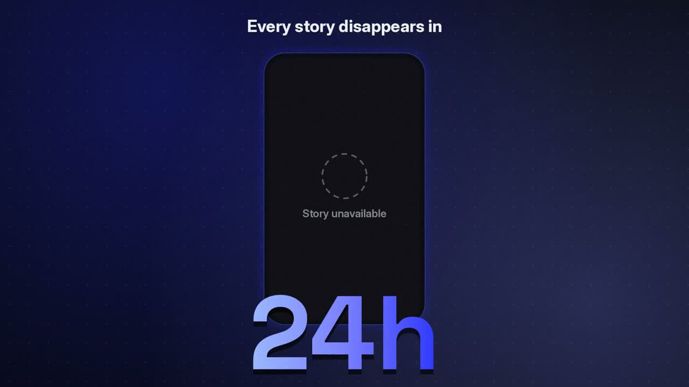

# Instagram Stories & Highlights Scraper

Archive Instagram stories before they disappear, and pull every highlight reel with all its photos and videos, from any public profile. No Instagram login, no cookies, no API key.

[](media/promo.mp4)

**[Run it on Apify →](https://apify.com/goat255/instagram-stories-highlights-scraper)**

## What you get

For each username:

- **Current stories**: every item in the live 24-hour tray, images and videos, with original-resolution media URLs and expiry times.
- **Highlight reels**: every saved highlight with its title, cover and item count.
- **Highlight items**: every photo and video inside each highlight, expanded.
- **A clear status per profile**: `ok`, `no_active_stories`, `private`, `not_found` or `fetch_failed` (retryable), so an empty result is never ambiguous.

```json
{
  "username": "example_user",
  "status": "ok",
  "isAccessible": true,
  "storyCount": 4,
  "highlightCount": 12,
  "highlightsFetchFailed": false,
  "stories": [{ "mediaType": "video", "videoUrl": "https://example.com/story.mp4", "takenAt": 1767225600, "expiringAt": 1767312000 }],
  "highlights": [{ "title": "Travel", "mediaCount": 18, "coverImageUrl": "https://example.com/cover.jpg", "items": ["..."] }]
}
```

## What people use it for

- Brand and competitor monitoring: see what accounts in your market post to stories every day.
- Story archiving: keep a permanent copy of time-limited campaigns and announcements.
- Content research and repurposing: study highlight structures and formats that work.
- Influencer vetting: review an account's highlights before a partnership.

## Run it

From the Apify Console, add one or more usernames and press Start. Or call it from code:

```bash
curl -X POST "https://api.apify.com/v2/acts/goat255~instagram-stories-highlights-scraper/run-sync-get-dataset-items?token=YOUR_APIFY_TOKEN" \
  -H "Content-Type: application/json" \
  -d '{"usernames": ["example_user"], "includeStories": true, "includeHighlights": true}'
```

## Use it from an AI agent

Works with Claude, Codex and any agent that speaks MCP or HTTP. See [AGENTS.md](AGENTS.md) for the input, output and a ready-made MCP setup.

## Pricing

Pay only for what you get: empty, missing and retryable profiles are not charged beyond a tiny start fee. Current prices are on the [Apify Store page](https://apify.com/goat255/instagram-stories-highlights-scraper).

## More actors

This page is a showcase; the actor itself runs on Apify. **[Check our profile for more such actors →](https://apify.com/goat255)**
